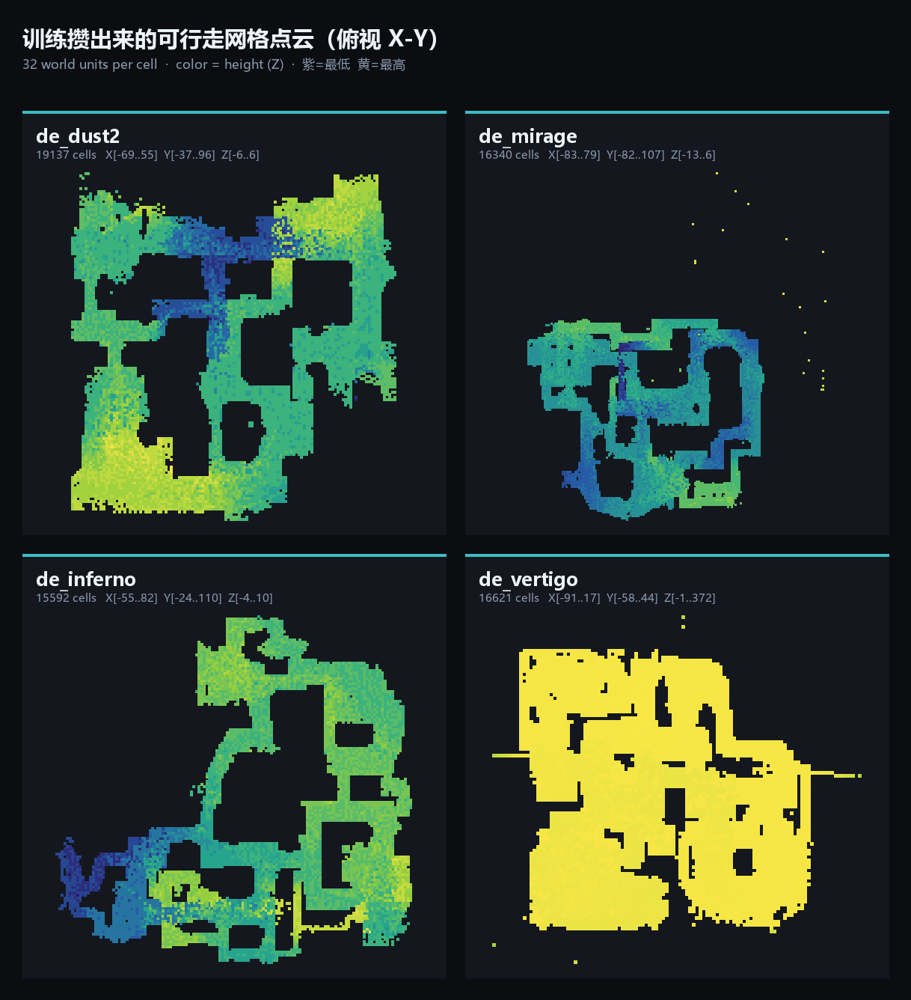
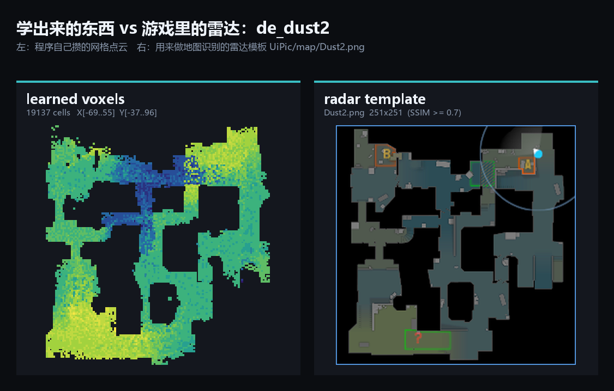
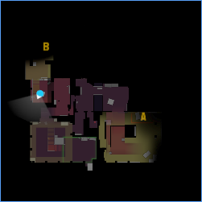
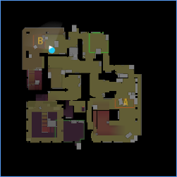
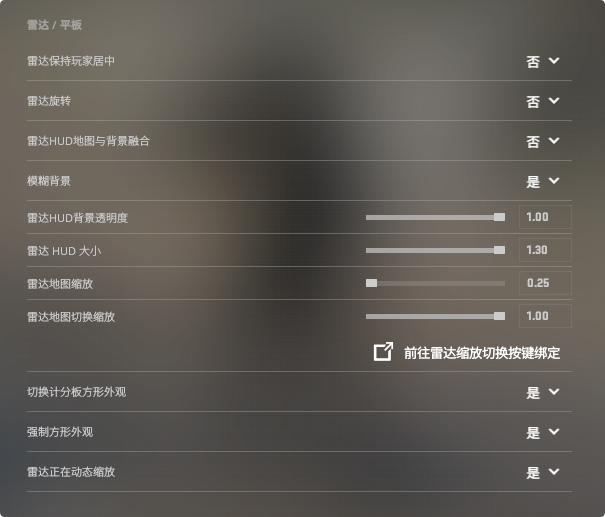

# CSCaseFlow

一个针对 **Counter-Strike 2（CS2）** 的自动化挂机与数据采集工具：**读游戏内存**拿到敌人坐标、血量、朝向，**模拟键鼠**完成瞄准、开火、行走，中间夹着最核心的一层——**自己攒一份地图数据**，用来回答"这个人我现在能不能打到"。主要用于窗口化的死亡竞赛/人机房挂机刷箱子、做自动化测试。

> 📝 技术详解见博客 [用 Python 给 CS2 写自动击杀脚本](https://github.com/XD-xiao/CSCaseFlow)
> ⚠️ **免责**：此类工具在 VAC 保护的服务器上使用几乎必然封号，只适合离线/人机环境研究，仅供学习。

---

## ✨ 功能特性（5 个模式）

启动时上下键选择，`END` 键随时退出并落盘地图数据。

| 模式 | 名称 | 说明 |
| ---- | ---- | ---- |
| 1 | 击杀（不用可视学习） | 随机走路 + 自动击杀，地图只读不写 |
| 2 | 击杀（用可视学习） | 同上，并把"看得见敌人的位置"记进地图 |
| 3 | 训练（不自动击杀） | 只采集数据，不动手 |
| 4 | 训练（自动击杀） | 边采集边打，攒地图最快 |
| 5 | 地图调试 | 只识别一次地图并打印，确认配置正确 |

核心能力：内存读取、主动攻击（闭环瞄准 + 点射）、自己攒地图、SSIM 地图识别、拟人化行走与防 AFK。

---

## 🔍 数据采集：读内存当眼睛

- **偏移量不硬编码**：交给 [a2x/cs2-dumper](https://github.com/a2x/cs2-dumper)，输出 `offsets.json`/`client_dll.json`，程序启动时**按字段名**沿继承链递归查找（见 `Uitlity.extract_offsets`）。游戏更新只需重跑一次 dumper，代码零改动；缺字段会拒绝启动。
- **实体列表两级索引**：实体分块存放，`list_index = (i & 0x7FFF) >> 9`、`entity_index = i & 0x1FF` 定位。玩家还有**两层对象**：`CCSPlayerController → m_hPlayerPawn（句柄，低 15 位才是索引）→ C_CSPlayerPawn`。
- **瞄准点按血量选骨骼**：满血（≥93）打头（骨骼 6），残血打胸（骨骼 4）；再沿敌人朝向前推 6 单位做提前量、对高度做固定补偿。骨骼链：`Pawn → m_pGameSceneNode → (+0x1E0) 骨骼数组`。
- **可见性直接用游戏算好的**：读本地玩家 `m_bSpottedByMask`（两个 32 位掩码）还原出"谁看见了我"，命中直接开打；掩码没有时才退回查自己攒的地图。`m_bHasMovedSinceSpawn` 用来跳过刚出生玩家的无敌时间。

## 🎯 主动攻击：闭环 + 点射

- **闭环瞄准**：每轮重读游戏真实视角 `m_angEyeAngles`，只走误差的 20%，角度差 < 0.1° 即停（上限 0.6s/500 次）。因为角度↔鼠标位移的换算永远算不准（灵敏度、DPI 都影响），闭环让常数不精确只影响收敛速度、不影响落点。位移用 `SendInput` 注入相对移动、分步发送、归一化 ±180°。
- **开枪前让游戏确认**：读 `m_iIDEntIndex`（准星指着谁），确认了才扣扳机——"瞄准是我的判断，开火是游戏的判断"，两者一致才开火。
- **点射**：每枪间隔 0.08s，用节奏换精度，不做压枪。
- **线程互斥**：主循环 3ms 扫实体、击杀线程 4ms 挑目标、行走线程随机转视角/WASD。`is_combat` 标志让行走在战斗时立刻松键让位；所有睡眠都切成 50ms 小片检查退出标志，退出用 `os._exit(0)` 硬退避免按键卡住。

## 🗺️ 训练：自己攒一份地图

内存只给"现在"，回答不了"墙后面的人打不打得到"。做法是把世界坐标量化成 **32 单位一格**的三维网格，用 `set` 存起来。

三种数据来源（训练模式 3/4）：
1. **控制台日志**：`mp_logdetail 3` 把每次命中的攻击者/被打者坐标打进日志，正则解析 `attacked` 行；
2. **可视学习**：敌人出现在可见状态时，把"我 ↔ 敌人"连成线；
3. **行走学习**：记录自己与敌人的位置。

写入时用 **3D Bresenham 连线**（记线不记点）。核心巧思：**两个人能互相打到，说明这条直线上没有墙，扫过的格子都可当成"空"**——于是同一份数据既是"可行走空间"又是"视线空间"，判断能否开枪变成一次查表（`can_shoot`：起终点都认识、且射线上每格都认识）。

四张图（Dust2/Mirage/Inferno/Vertigo）跑下来每张约 1.5～1.9 万个格子，轮廓与游戏雷达基本吻合：

数据用 `pickle` 存成 `mapData/<地图名>.pkl`（先写临时再 `os.replace`，10s 自动落盘，`RLock` 并发保护）；每记一个新格子"嘀"一声，不看屏幕也能感知进度。

---

## 🖥️ 地图识别：截图 + SSIM

截取游戏窗口 (13, 36) 处 276×276 的雷达区域，与 `UiPic/map/` 模板比对 SSIM，取最高且 > 0.7 的一张；文件名带 `-数字` 后缀视为同一张图（如 `Vertigo-1/2.png` 都归 `Vertigo`），每 30s 重新识别以便换图自动切换。

| Vertigo-1 | Vertigo-2 |
| --- | --- |
|  |  |

代价是画面必须固定：窗口化、分辨率固定、**关掉雷达保持居中与旋转**、固定雷达大小缩放。

---

## 🚀 运行方法

### 前置条件

- Windows、Python 3.10+、窗口化 CS2（进程 `cs2.exe`，建议 1280×720）
- 依赖：`pip install pymem pynput pygetwindow psutil orjson opencv-python scikit-image pyautogui`

### 1. 配置授权令牌

`main.py` 会校验 `Setting.py` 里的 `ActivationToken`（JWT，HS256，校验网络时间与 `exp`），过期会拒绝启动。用 `python test.py` 重新生成并填回即可。

### 2. 配置 CS2 命令

执行 `Setting/myCFG.cfg` 中的命令，其中 `mp_logdetail 3` + `con_logfile console.log` 是训练采集日志的前提，`bind "j"` 用于自动买枪+防 AFK。训练模式还需把 `Setting.py` 的 `AUTOKILL_CONSOLE_LOG_PATH` 改成自己的 CS2 日志路径。

### 3. 启动

1. 打开 CS2 进入死亡竞赛/人机房；
2. `python main.py`，上下键/数字键选模式（见上方模式表），回车确认；
3. 按 `END` 退出并自动落盘。

所有可调参数集中在 `Setting/Setting.py`（网格大小、点射间隔、行走范围、识别阈值等），业务代码不含魔数。

---

## ⚠️ 已知局限

| 问题 | 现状 |
| ---- | ---- |
| 没有寻路（有地图数据但没写 A*） | 行走目前是随机 WASD + 随机转视角 |
| Bresenham 连线会穿墙标格子 | 不同楼层/隔墙连线会产生少量假数据 |
| 掩码下标是试出来的 | 游戏更新需重新校准，对不上时退化成"都不敢打" |
| 一组魔数（骨骼偏移、高度补偿、45.72 系数） | 换分辨率/灵敏度要重调，已集中在 `Setting.py` |
| 抗检测基本为零（`pymem` 直读内存） | 只在离线/人机环境用 |
| 实体列表读空直接退出 | 简单粗暴但不会乱开枪 |

---

## 致谢与声明

- 内存读取参考 [Jesewe/cs2-esp](https://github.com/Jesewe/cs2-esp)，偏移量来自 [a2x/cs2-dumper](https://github.com/a2x/cs2-dumper)。
- 大部分代码由 AI 辅助编写；仅供学习研究游戏内存结构与自动化控制，使用风险（VAC Ban 等）自负，请勿在官方匹配或破坏他人体验的场合使用。
